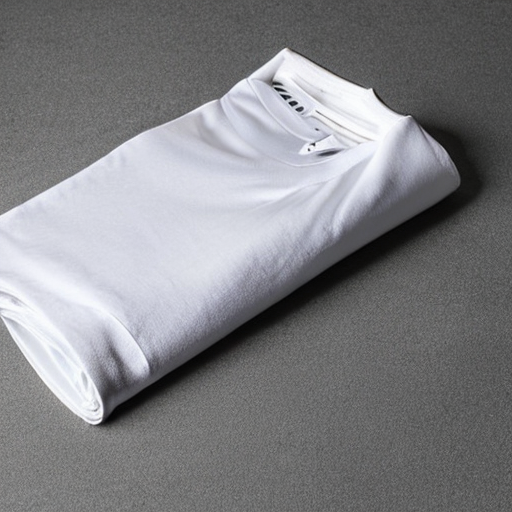
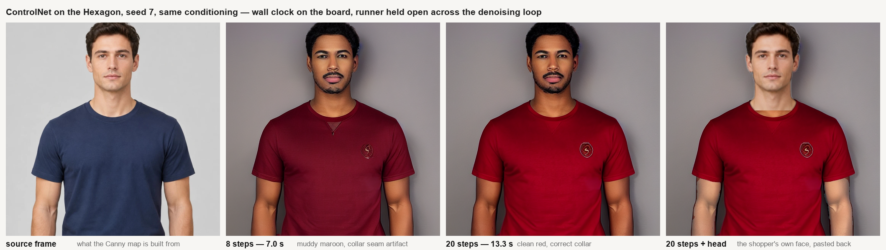
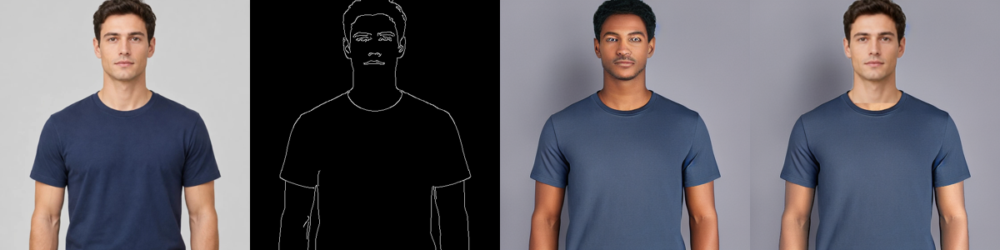

# Stable Diffusion on the Hexagon NPU

**Working.** Stable Diffusion v2.1 at 512×512, w8a16, running wholesale on the
QCS8275's Hexagon v75 from Qualcomm AI Hub's prebuilt context binaries:

```bash
make board-sd-export                                  # once, ~15 s
make board-sd PROMPT="studio product photo of a folded white cotton t-shirt on a grey background, soft lighting, high detail"
```




That image is 20 denoising steps, seed 42, guidance 7.5, generated entirely on
the board with nothing on the network.

## The number

**0.30 seconds per denoising step.** 20 steps is **5.9 s of NPU time**, and
**8.8 s of wall clock**.

| | Time |
|---|---|
| One UNet execution | **148–159 ms** |
| One denoising step (2 executions, cond + uncond) | **0.30 s** |
| 20 steps, NPU time | **5.9 s** |
| Text encoder, per prompt | 10 ms |
| VAE decode, 64×64×4 → 512×512×3 | 272 ms |
| **Total NPU compute for one image, 20 steps** | **~6.2 s** |
| **End to end, 20 steps** | **8.8 s** |
| **Total NPU compute, 8 steps** | **~2.7 s** |
| **End to end, 8 steps** | **5.1 s** |

Those wall-clock figures are with the runner **held open across the denoising
loop**, which it was not when this was first written: it used to be 28.3 s at
20 steps and 12.2 s at 8, almost all of it reloading the UNet once per step.
See [persistent-runner.md](persistent-runner.md), and "The runner could not
stay loaded" below.

148–160 ms per UNet execution across several runs, and the same figure for 20
back-to-back executions down a runner that is already loaded — so there is no
warm-up effect and no thermal sag over a single image. The board was also
running the billboard daemon throughout, which accounts for most of the
spread.

Model load, now paid **once per image** rather than once per step: 0.96–1.10 s
for the UNet, 0.57 s for the text encoder, 0.38 s for the VAE. Peak host RSS:
854 MB for the UNet, 430 MB text encoder, 77 MB VAE — the .pte is mapped, so
this tracks the context binary's size.

The gap that used to sit between 6 s of compute and 31–45 s of wall clock was
never the hardware — it was one UNet reload per step, because the prebuilt
runner could not be held open. It has since been rebuilt, and the gap is
**2.9 s** over the whole image: one load each for the text encoder, the UNet
and the VAE, plus the host-side scheduler arithmetic.

### Verdict: fast enough, reliable enough only for batch-and-pick

The brief put the viability line at roughly 2 s/step. This is **0.30 s/step**
on the NPU and **0.31 s** of wall clock, six times under it. Concretely:

- **20 steps: 5.9 s of compute, 8.8 s wall.** A "press the button and wait"
  mode, comfortably.
- **8 steps: 2.4 s of compute, 5.1 s wall** — measured, not extrapolated.
  But **8 steps is only enough for some subjects**: the folded-t-shirt product
  shot at 8 steps is indistinguishable from the 20-step one, while the same
  prompt describing *a person* comes out as unusable blur at 8 and is sharp at
  20. Flat-lay product photography converges early; people do not. Budget 20
  steps for anything with a figure in it — which the board can now afford,
  and could not when 20 steps cost 28 s.
- Three graphs, 1.3 GB of weights, **all three can be resident on the cDSP at
  the same time** (measured — see below), so a daemon can keep them warm the
  way `board_billboard_daemon.py` does.

What it is not is a live effect. 0.30 s/step against the billboard's 37 ms
frame means diffusion is a still-image feature — press a button, wait a few
seconds, get a picture — not something to put in the camera loop.

**And speed is no longer the binding constraint — reliability is.** About one
generation in six is usable (see "What this is not, yet"), which is fine for
generating a garment catalogue offline and picking the good ones, and not fine
for a passerby pressing a button once. Closing that gap means generating four
candidates and scoring them (InternVL3-1B is already on this board and could
do the picking, at ~26 s of NPU time for the four), or conditioning on a real
photo through img2img so the model cannot invent a different scene.

## How it fits together

Three pieces, and the middle one is the only one we wrote:

1. **Qualcomm AI Hub's context binaries** — `text_encoder.bin`, `unet.bin`,
   `vae.bin`, already compiled for the QCS8275's Hexagon v75 at w8a16. Nothing
   is quantized or lowered on our side. Release **0.62.2**, 1.3 GB.
2. **`scripts/board_sd_export.py`** wraps each binary in an ExecuTorch `.pte`
   with `from_context_binary()`, and dumps every graph's shapes and
   quantization encodings to `encodings.json`.
3. **`scripts/board_sd_driver.py`** runs the three graphs through the prebuilt
   generic `qnn_executor_runner` and does the scheduler, classifier-free
   guidance and requantization in numpy.

Prompt tokenization happens on the Mac (`scripts/make_sd_tokens.py`), the same
split as `make_whisper_raw.py` and `make_face_raw.py`.

### No diffusers, nothing installed on the board

Upstream's `qaihub_stable_diffusion.py` needs `diffusers` and `piq`, and
downloads several GB of `stabilityai/stable-diffusion-2-1-base` purely to reach
`UNet2DConditionModel.time_embedding` — because the UNet it expects takes a
precomputed `[1, 1280]` time embedding.

**This release's UNet takes a scalar timestep instead**, with the time
embedding folded into the graph. So none of that is needed: no `diffusers`, no
`piq`, no multi-GB download, nothing added to `et-venv`. The scheduler is a
page of numpy — Euler was ported from the bundle's own `runner.cpp`, and
DPM-Solver++(2M) and the Karras sigma spacing were added on top (see "Getting
better pictures out of it" below).

## Version compatibility: not a problem, and the warning is a red herring

The board's QAIRT runtime is 2.49. Context binaries built with a *newer* QAIRT
are rejected. The current AI Hub release (0.64.0) is built with QAIRT 2.50 and
would be; **release 0.62.2 is built with QAIRT 2.45** and loads cleanly.
`metadata.json` names the version it was built with:

```json
"tool_versions": { "qairt": "2.45.0.260326154327" }
```

At runtime you will see:

```
[WARNING] Qnn API version 2.38.0 is used. The version is tested against 2.35.0.
```

That is the ExecuTorch QNN shim's own API version, nothing to do with the
context binary. Ignore it — it appears on every model we run, Whisper included.

## cDSP memory: 1.3 GB is fine

The real risk was protection-domain memory, not RAM — InternVL3-2B died on
exactly that (its encoder fit alone, all its graphs together did not), and
Stable Diffusion has three large graphs with an 834 MB weights buffer in the
middle of them.

**It holds.** All three contexts initialise and allocate tensors in one
process, simultaneously, with the billboard daemon's BiSeNet also loaded:

```
RESULT text_encoder.bin: init_rc=0 alloc=['Error.Ok'] (contexts still held: 1)
RESULT unet.bin:         init_rc=0 alloc=['Error.Ok'] (contexts still held: 2)
RESULT vae.bin:          init_rc=0 alloc=['Error.Ok'] (contexts still held: 3)
RESULT all three held simultaneously
```

So a warm daemon holding all three is viable — and that is now what the driver
does. Measured again under the real configuration, sampling `ps` through a
ControlNet generation with the billboard daemon live, the peak is **five QNN
contexts resident at once**: the daemon's BiSeNet and SegFormer, plus
ControlNet (369 MB), the UNet (881 MB) and the VAE (64 MB). No failure, and
10.4 GB of host RAM still free. The text encoder is not in that list because
the driver closes it as soon as its one call is done.

One failure *was* seen, once, and is worth recording because it looks fatal:

```
<E> fastrpc memory map for fd: 42 with length: 874512384 failed with error: 0x1
<E> Mapping buffer fd 42 to FastRpc failed on domain 3
<E> Failed to map weights buffer on host, err 3
<E> Could not allocate persistent weights buffer!
```

That is the UNet's 834 MB weights buffer failing to map onto the cDSP. It did
not reproduce under any option combination afterwards — it is transient
contention with whatever else is on the DSP, not a ceiling. Keep
`use_multi_contexts=False` anyway: "persistent weights buffer" is a
weight-sharing feature, and there is nothing to share between three separately
loaded `.pte` files.

## Five things that had to be worked around

### 1. The bundle's own runner does not fit this model

`qaihub_stable_diffusion_runner` executes the UNet as
`(latent, time_embedding[1,1280], text_emb)`. The graph in release 0.62.2 is:

| | name | shape | dtype | scale | offset |
|---|---|---|---|---|---|
| in[0] | `timestep` | [1, 1] | ufixed16 | 0.0145113 | 0 |
| in[1] | `latent` | [1, 64, 64, 4] | ufixed16 | 0.00039353 | −36942 |
| in[2] | `text_emb` | [1, 77, 1024] | ufixed16 | 0.00033883 | −23954 |
| out[0] | `output_latent` | [1, 64, 64, 4] | ufixed16 | 0.00032440 | −26599 |

Different order *and* a scalar timestep where the runner wants a 1280-wide
embedding. `qaihub_stable_diffusion.py` hardcodes the old order too —
`encoding["unet_input"]["scale"][0]` for the latent, `[1]` for the time
embedding. Reading the encodings **by tensor name** rather than by index is
what makes this robust; `encodings.json` carries the names.

### 2. The runner could not stay loaded — fixed

This was the single highest-value fix available, and it has been made.

The generic `qnn_executor_runner` *source* in the bundle supports
`--input_list_path -`: load once, then one inference per line of stdin, with a
`FRAME_READY` marker on stdout. **The prebuilt binary predated it** — Aug 13,
with no `FRAME_READY` string in it — and there was no compiler on the board.
There is one now (`~/toolchain`, no root, see
[board-toolchain.md](board-toolchain.md)), the runner has been rebuilt as
`qnn_executor_runner_persistent`, and `board_sd_driver.py` holds every graph
open for the length of one image. What it predicted, against what it did:

| | reloading | predicted | **measured** |
|---|---|---|---|
| SD 2.1, 20 steps | 28.3 s | ~8 s | **8.8 s** |
| SD 2.1, 8 steps | 12.2 s | — | **5.1 s** |
| ControlNet, 20 steps | 48.0 s | ~21 s | **13.3 s** |
| ControlNet, 8 steps | 20.2 s | — | **7.0 s** |

ControlNet beat its own estimate because that estimate assumed the ~0.65 s a
step of requantizing 13 residuals stayed. It did not: those residuals are
exchanged as files, the scratch moved from eMMC to `/dev/shm`, and 27 MB a
step at 1.3 GB/s instead of 130 MB/s took most of it out. What is left is
0.15 s a step of host-side work, of which **83 ms is the arithmetic** — 6.7M
elements dequantized and requantized twice, none of the 13 encoding pairs
matching so the fast path never fires — and the remainder is those tensors
still crossing a filesystem on the way in and out.

Per step, in steady state (the first step still pays the model load):

| | NPU | wall, reloading | wall, held open |
|---|---|---|---|
| SD 2.1 | 0.30 s | 1.34 s | **0.31 s** |
| ControlNet | 0.37 s | 2.33 s | **0.52 s** |

SD 2.1 is within 10 ms of its own NPU time. There is nothing further to win
there without a faster graph.

The output is **byte-identical** both ways — checked at 8 and 20 steps on both
model sets, against images generated before the change. `--persistent_runner
off` restores the old launch-per-stage path, and so does the absence of the
patched binary; a warm process that dies mid-image is dropped and the rest of
that image falls back to per-call launches rather than failing.

### 3. It is v-prediction, not epsilon

This cost the most time and nothing in the metadata says it. The bundle's
runner treats the UNet output as an epsilon prediction, and
`qaihub_stable_diffusion.py` goes out of its way to force
`scheduler.config.prediction_type = "epsilon"`. Run that way, every image comes
out as saturated RGB static.

The output is **v-prediction**. The signature is unmistakable once you sweep
it — feed the UNet pure noise at level *s*, tell it timestep *t*, and correlate
its output with its input:

| timestep | best input level | correlation | output std |
|---|---|---|---|
| 2.9 | 0.05 | 0.987 | 0.768 |
| 14.5 | 0.10 | 0.993 | 0.882 |
| 116 | 0.25 | **0.996** | 0.937 |
| 232 | 0.35 | **0.997** | 0.838 |
| 406 | 0.50 | 0.996 | 0.627 |
| 580 | 0.70 | 0.990 | 0.412 |
| 798 | 0.70 | 0.897 | 0.171 |
| 951 | 0.20 | 0.372 | 0.185 |

An epsilon model fed pure noise predicts that noise back at every timestep —
correlation near 1 throughout. This one is near-perfect at low *t* and collapses
at high *t*, which is exactly `v = α·ε − σ·x₀`: at low *t*, α→1 and v→ε; at
high *t*, v→−x₀, which has almost nothing to do with the input. Switching the
Euler step to

```python
original = guided * (-sigma / np.sqrt(sigma**2 + 1)) + latent / (sigma**2 + 1)
```

turned static into photographs on the first try. `--prediction_type epsilon` is
still there if a future release changes back.

## Getting better pictures out of it

Everything above makes it *run*. Three changes make it run *well*, and the
striking thing is that **none of them costs any extra NPU time** — all three
are host-side arithmetic around the same two UNet executions per step.

Measured on one prompt ("studio photo of a man wearing a navy blue crew neck
t-shirt, plain grey background, soft lighting"), seed 7, so the comparisons
are like for like:

| | steps | NPU time | result |
|---|---|---|---|
| Euler + linspace, empty uncond | 20 | 6.0 s | soft, washed out, low contrast |
| Euler + linspace, empty uncond | 8 | 2.4 s | unusable blur |
| **DPM++(2M) + Karras**, empty uncond | 20 | 6.0 s | sharp fabric and skin, one mangled hand |
| DPM++(2M) + Karras, empty uncond | 40 | 11.9 s | hand resolved |
| **DPM++(2M) + Karras + negative prompt** | **20** | **6.0 s** | **best — clean hands, studio lighting, crisp backdrop** |
| DPM++(2M) + Karras + negative prompt | 40 | 11.9 s | no better than 20 |

1. **DPM-Solver++(2M)** instead of Euler. It is second order, reusing the
   previous step's x0 prediction, so it costs exactly one UNet pair per step —
   the same as Euler — and converges much sooner. `--sampler euler` restores
   the bundle's behaviour.
2. **Karras sigma spacing** (rho=7) instead of linspace. It spends more of the
   step budget at low noise, where detail is decided. The UNet needs a
   timestep rather than a sigma, so the schedule inverts the training sigma
   table to get one. `--schedule linspace` restores the old spacing.
3. **A negative prompt.** This is the big one, and it is *free*: the
   unconditional pass runs anyway for classifier-free guidance, so putting
   something in it instead of the empty string costs nothing at all.
   `board_sd_run.sh` now defaults to
   `"blurry, low quality, distorted, deformed hands, extra limbs, watermark,
   text, cropped, out of focus"`. `PLAIN=1` goes back to an empty uncond.

**More steps is not the lever.** 40 steps with a negative prompt is no better
than 20 with one, and 40 without is worse than 20 with. On a w8a16 model the
quantization floor is reached well before the sampler runs out of road, so the
budget is better spent on the free changes than on wall clock.

### 4. The timestep input cannot represent t=999

`scale = 0.0145113`, `offset = 0`, uint16 — so the representable range is
`[0, 65535 × 0.0145113]` = **[0, 951.07]**. The standard 20-step schedule starts
at t=999, which saturates: the first and noisiest step would silently be told
the wrong noise level.

The driver caps the schedule at `floor(65535 × scale)` and derives the sigmas
from the capped timesteps, so the first step starts at t=951, σ=11.03 instead
of t=999, σ=14.61. The difference is visible — with the cap the astronaut
prompt actually produces an astronaut.

### 5. Exporting all three in one process does not work

`from_context_binary()` a second time in the same interpreter dies inside the
bundle's own preprocessor:

```
File "backends/qualcomm/qnn_preprocess.py", line 177, in preprocess_multimethod
    for i in range(num_sub_graphs):
TypeError: range() missing 1 required positional arguments: "end"
```

preceded by `No QnnManager active for backend type kHtpBackend in the current
QnnManagerContext` — stale lifecycle state from the first call.
`board_sd_export.sh` runs one stage per interpreter, which also guarantees only
one set of weights is mapped onto the cDSP at a time.

Beyond these, the usual four on-board workarounds from
[whisper-npu.md](whisper-npu.md) apply unchanged: `PYTHONPATH=/home/arduino/git`
ahead of site-packages, the `QNN_SDK_ROOT` shim whose `lib/x86_64-linux-clang`
symlinks to the aarch64 QAIRT libraries, and the `LD_LIBRARY_PATH` /
`ADSP_LIBRARY_PATH` incantations.

### A sixth, on the Mac side

`transformers==5.0.0rc1` — which `optimum-executorch` pins, see CLAUDE.md —
ships a `CLIPTokenizer` that raises on construction against the installed
`tokenizers`:

```
TypeError: RobertaProcessing.__new__() got an unexpected keyword argument 'cls'
```

`make_sd_tokens.py` implements CLIP's BPE directly from `vocab.json` and
`merges.txt` rather than disturbing the pinned venv — which is all the bundle's
README asks for anyway. SD 2.x pads to 77 with `"!"` (id 0), not EOS.

## What this is not, yet

- **No img2img.** The SD 2.1 set starts from noise and cannot do otherwise —
  its `vae.bin` is decoder-only, so there is no way to get an image *into*
  latent space. (ControlNet conditioning is a different mechanism and does
  work — see below. It needs no encoder because it conditions in pixel space.)
- **512×512 only.** Baked into the context binaries.
- **The w8a16 artifacts cannot be flagged away.** The face-swap work found
  that the QCS8275 runs HTP **fp16** — contrary to QNN's docs — and that
  exporting a model unquantized (`quant_dtype=None`, which sets
  `use_fp16=True`) fixed quantization damage there for a 4% speed cost. That
  does not transfer here. These graphs arrive from AI Hub **already compiled**
  as w8a16; `from_context_binary()` only wraps a finished context binary, and
  the per-tensor scale/offset read out of them is proof the precision is
  baked in. `use_fp16` is a compile-time choice, and nothing here compiles.
  Getting fp16 Stable Diffusion would mean exporting it from PyTorch on the
  board — an 865M-parameter UNet, against the 50M-parameter models that path
  has handled so far. So the 1-in-6 hit rate and the ringer-tee artifact are
  properties of the binaries, to be worked around rather than configured away.
- **The hit rate is about 1 in 6, and that is the real limit.** Six seeds of
  "studio product photo of a folded navy blue cotton t-shirt on a plain grey
  background, soft lighting, high detail" gave one clean folded tee, one
  near-miss, and four images that are not a t-shirt at all — a fabric swatch,
  a striped textile, a shirt with a third sleeve, and three yellow tins.
  Raising guidance from 7.5 to 12 did not help: **the same seeds failed the
  same way**, so the composition is decided by the initial latent, not by how
  hard the prompt is pushed. The good images above are cherry-picked, as
  every Stable Diffusion image anyone shows you is.

  This is normal Stable Diffusion behaviour rather than a quantization
  artifact, but it is the thing that decides what can be built: batch-and-pick
  is fine, one-shot unattended generation is not. Note that it is specific to
  text-to-image from pure noise — img2img cannot wander off into yellow tins,
  because it starts from a real photo.
- **Compositional prompts are weak.** "An astronaut riding a horse" gives you
  the astronaut and the setting but not the horse.
- **It is description-conditioned, not instruction-following.** There is no
  image input — the only conditioning channel is the 77x1024 CLIP text
  embedding — so an edit instruction like "put that person in those clothes"
  has no referent and decodes to incoherent mush. Prompts have to *describe
  the desired output*, not request an edit to something. Instruction editors
  (InstructPix2Pix) and virtual try-on models (IDM-VTON, OOTDiffusion,
  CatVTON) are the family that takes that interface, and AI Hub publishes
  none of them for this chipset. No fp32 reference was run to
  separate quantization loss from the 20-step schedule — upstream's PSNR/SSIM
  check needs `diffusers` and `piq` on the board.
- **One prompt per launch.** The graphs stay resident for the length of one
  image and are closed with the process; nothing persists between runs. A
  daemon that kept them open across images would save the ~2 s of model load,
  at the cost of holding 1.3 GB of cDSP context while nobody is generating.

## ControlNet-Canny: conditioning on a real photo — working

```bash
make board-cn-export                                    # once, ~20 s
make board-cn IMAGE=frame.jpg PROMPT="studio photo of a man wearing a bright red t-shirt, white studio backdrop"
```

The export needs the release unpacked on the board first, and the raw `.bin`
files are deleted afterwards because the `.pte` embed them and the board's
disk runs close to full:

```bash
adb shell "mkdir -p /home/arduino/controlnet && cd /home/arduino/controlnet && \
  curl -sLo cn.zip https://qaihub-public-assets.s3.us-west-2.amazonaws.com/qai-hub-models/models/controlnet_canny/releases/v0.62.2/controlnet_canny-qnn_context_binary-w8a16-qualcomm_qcs8275.zip && \
  unzip -q cn.zip -d extracted && rm cn.zip"
```

**Use release 0.62.2, not the current one.** 0.62.2 is built with QAIRT 2.45;
0.64.0 is 2.50, above the board's 2.49 runtime. Same rule as the SD 2.1 set.

An earlier version of this section said the UNet's three sealed inputs made
image conditioning impossible without new C++ or a second runtime. **That was
wrong**, and it was wrong in a way worth recording: the conclusion came from
the *bundle's* dedicated SD runner, which takes exactly three binaries — but
this project does not use that runner. It drives the generic
`qnn_executor_runner` from `board_sd_driver.py`, whose `Stage` class builds
each graph's inputs by name out of `encodings.json`. A fourth graph and a wider
input list were incremental there, not a rewrite.

It now runs. The signatures, confirmed against the context binaries on export:

```
controlnet.bin   in:  text_emb [1,77,768], image_cond [1,512,512,3],
                      latent [1,64,64,4], timestep [1,1]
                 out: down_block_0..11 + mid_block   (13 residuals)

unet.bin         in:  timestep, latent, text_emb,
                      controlnet_downblock0..11, controlnet_midblock  (16 inputs)
                 out: output_latent [1,64,64,4]
```

`image_cond` is **[1, 512, 512, 3] in pixel space**, so this path needs no VAE
encoder at all — the blocker that still gates img2img on the SD 2.1 set simply
does not apply.

### Measured

| | NPU time |
|---|---|
| One ControlNet execution | **77 ms** |
| One UNet execution | **108 ms** |
| One denoising step (4 runs: 2 ControlNet + 2 UNet) | **0.37 s** |
| 20 steps | **7.4 s** |
| Text encoder, per prompt | 4 ms |
| VAE decode | 268 ms |
| **End to end, 20 steps** | **13.3 s** |
| **End to end, 8 steps** | **7.0 s** |

Model load: 1.15 s UNet, 0.62 s ControlNet, 0.33 s text encoder, 0.36 s VAE.
Peak host RSS: 852 MB UNet, 363 MB ControlNet.

The UNet is **faster** than SD 2.1's (108 ms against 159) despite being the
same 865M parameters, because SD 1.5's cross-attention is 768 wide against
2.1's 1024. The whole step still costs more — 0.37 s against 0.30 — because
there are four graph runs instead of two.

The wall-clock gap used to be wider here than for SD 2.1 (2.33 s per step
against 1.34): two model reloads per step instead of one, plus requantizing 13
residuals — 6.7M elements — between ControlNet's output encodings and the
UNet's input encodings, twice per step. **None of the 13 pairs share an
encoding**, so the fast path never fires. Holding the runners open removed the
reloads and 0.52 s a step is what is left, of which 0.37 s is the NPU, 83 ms
is that requantization and the rest is tensors crossing a filesystem.

### Three things that differ from the SD 2.1 set

This is a **complete, separate SD 1.5 stack**, not an add-on. Do not mix
binaries between the two.

- **Epsilon, not v-prediction.** `--prediction_type epsilon`. Opposite of 2.1.
- **768-wide text embeddings** (CLIP ViT-L/14) against 2.1's 1024, and the
  tokenizer **pads with EOS (49407)**, not with `"!"` (0) as SD 2.x does.
  `make_sd_tokens.py --base sd15` handles it. This is quiet when wrong: on a
  short prompt the padding is 65 of the 77 positions and the text encoder
  attends to all of them.
- **The timestep input reaches 999.** Its scale is 0.015243763, so
  `65535 x scale = 999.0` exactly — none of SD 2.1's saturation at 951, and the
  schedule needs no cap.

### It removes the 1-in-6 failure class

This was the point of the exercise, so it was measured the same way. Six
seeds, the prompt "studio photo of a man wearing a navy blue crew neck
t-shirt, plain grey background, soft lighting", conditioned on the Canny map
of one photo:

| | text-to-image, no conditioning | ControlNet, same prompt |
|---|---|---|
| Coherent subject | **1–2 of 6** | **6 of 6** |
| Outright wrong subject | 4 of 6 — fabric swatches, stripes, three yellow tins | **0 of 6** |
| On-prompt garment colour | — | 4 of 6 |
| Pose / framing | random | identical to the source, every time |

**Zero compositional failures.** Every seed produced a man, facing the camera,
in a t-shirt, framed exactly like the source photo. The two imperfect ones
were colour, not composition: one ringer tee (the seam artifact below) and one
grey instead of navy.

That is the difference between "generate four and pick" and something you
could put in front of a stranger. The 1-in-6 problem documented above is a
property of sampling from pure noise, and conditioning is simply not that.

The six-seed table was run at 20 steps. One 8-step conditioned run also came
out clean, which would halve the cost to ~2.9 s of NPU time — the conditioning
is doing work the sampler would otherwise have to. That is a single
observation, not a measurement; worth a proper sweep before relying on it.

### 8 steps against 20, now that both are affordable



Same seed, same prompt, same Canny map, so the only variable is the step
count. Conditioning does keep 8 steps from the blur that unconditioned
text-to-image falls into — this is a person in a t-shirt either way, framed
like the source. What 8 steps gets wrong is **colour and construction**: "a
bright red crew neck t-shirt" comes out a muddy maroon with a V-shaped seam
hallucinated at the collar, and 20 steps gets a clean red and a correct crew
neck.

That is a 7.0 s image against a 13.3 s one. Before the runner was held open
the same choice was 20.2 s against 48.0 s, which is why the generate mode
shipped at 8 — the quality difference was known and unaffordable. It is
affordable now.

### What the conditioning actually does

The pose, framing, body and garment silhouette follow the source photo
exactly. What it does **not** carry is identity — Canny edges describe shape,
not a face, so the person who comes out is not the shopper. This composes with
the existing head matte or the GHOST swap rather than replacing either.

One artifact worth knowing, because it looks like a bug and is not:
**Canny picks up a garment's construction seams — the collar band and the
sleeve hems — and ControlNet reads those internal lines as colour-block
boundaries.** Asking for "a bright red t-shirt" over a photo of a plain navy
tee reliably produces a *ringer* tee: red collar, red sleeves, different body.
Lowering `--conditioning_scale` to 0.7 and raising guidance to 9 barely moved
it; dropping the colour word "grey" from the prompt changed it to red-and-black
*stripes* rather than solid red. The lines are in the conditioning, so the fix
is a cleaner edge map (higher Canny thresholds, more blur) rather than a
sampler knob — `--low` / `--high` on `make_canny_raw.py` are exposed for that.

### Giving it back the right face

ControlNet gets the garment right and the face wrong, and the fix is to not
generate the face at all:

```bash
make board-cn-tryon IMAGE=frame.jpg GARMENT="a bright red crew neck t-shirt"
```



Four stages, all already on the board — ControlNet for the garment, BiSeNet
for the head matte (11.9 ms), ATR SegFormer to label the generated body
(23 ms), and a composite. **The composite is a paste, not
a warp**, and that is the whole trick: because the generation was conditioned
on *this* photo, the generated head is already in the same place at the same
scale as the real one. Compare `garment_overlay.py`, which pastes a head onto
a stock product shot and has to scale by eye separation to make it land.

So the face is not improved, it is *theirs* — the correct pixels, composited
back. Identity is exact by construction rather than by a similarity score.

The **arms** belong to the generated person, so their skin tone can differ
from the real face. `sd_head_composite.py` corrects that by shifting the
generated skin toward the head's — the direction that keeps the face exact
rather than dragging it toward a stranger's colouring.

Doing that needs to know which pixels are skin, and the first attempt — a
YCrCb chrominance detector — **fails on warm garments**, because skin and a
red shirt occupy the same Cr range. Asking for a red t-shirt produced
yellow-green arms and a washed-out shirt, since the correction was computed
over, and applied to, both.

The fix is **ATR SegFormer** (`board-personseg`, 24.9 ms on the Hexagon,
[personseg-npu.md](personseg-npu.md)), which has an explicit `Upper-clothes`
class and separate `Left-arm` / `Right-arm` classes. A label per pixel instead
of a colour guess, so a red shirt stops being ambiguous by construction — the
same property the billboard already relies on to put a forearm in front of a
garment. `sd_head_composite.py` reuses `person_matte.body_masks()` rather than
re-deriving it, and `board_cn_tryon.sh` runs the segmenter on the *generated*
body as step 3. With those masks the correction is on by default; without
them it stays off, and `NO_SEG=1` skips the stage.

Note it is BiSeNet that is wrong for this, despite also having a `cloth`
class: BiSeNet is a *face* parser trained on face-filling crops, its `cloth`
is roughly the collar, and on a whole body it hallucinates (see
[faceparse-npu.md](faceparse-npu.md)). Two models with a garment class, only
one of which can find a garment on a torso.

### Wired into the billboard

`generate` is a mode in `board_billboard_daemon.py`, alongside `billboard`,
`tryon`, `faceswap` and `segment`. Pick it in the web UI, choose a garment,
press the shutter: **~7.5 s** at 8 steps and **~14 s** at 20, all on the
board. It was 21–26 s at 8 steps before the runner was held open, which is
also why 20 steps is now on the table for this mode — see
[persistent-runner.md](persistent-runner.md).

Four stages per shutter, three of them already on the Hexagon:
ATR SegFormer for the silhouette (25 ms), ControlNet + UNet + VAE for the
garment, BiSeNet for the head matte (12 ms), then the composite.

The logic lives in `scripts/board_tryon_gen.py`; the daemon gets one branch
modelled on the face-swap one. Prompts are **pre-tokenized**
(`make_tryon_prompts.py`, pushed to `/home/arduino/bb/prompts`) rather than
tokenized at shutter time — a shop has a catalogue, not a text box, and it
keeps CLIP's vocabulary off the board.

Two things were needed to make it work on a real camera frame rather than a
posed photo, and both were found by running it rather than by reasoning:

**Mask the conditioning to the person.** ControlNet follows every edge it is
given, and a room is full of them. Conditioned on a raw frame it faithfully
generated *the room* — ceiling light, picture frames and all, with a sliver of
garment at the bottom. Running the segmenter first and zeroing the Canny map
outside the silhouette leaves only the body to follow. This is the single
change that took the output from unusable to usable.

**Gate on framing, with this mode's own thresholds.** The conditioning is the
centre square of the frame, so a face that fills it leaves no torso to dress.
The daemon already has `check_alignment`, but it is tuned the opposite way —
the billboard wants a *big* head to cut out (`FACE_MIN` 0.28), while this
wants a half-body shot. `board_tryon_gen.framing_guidance` asks for a face
between 7% and 20% of frame width, sitting in the upper part, and says "step
back — we need your shoulders and chest in frame" when it is not. A capture
requested from a pose that cannot produce one is dropped rather than spending
26 s discovering it.

**Not yet verified with a correctly-framed shopper.** Everything above is
measured — the mode runs end to end through the web API, the silhouette
masking demonstrably removes the room, the gate fires correctly on a live
frame at 201 px — but every generated frame so far has been a close-up,
because nobody has stood at the distance the gate now asks for. The output at
proper framing is the one thing still to confirm.

### Method note: reading a release without downloading it

`metadata.json` is the fastest way to learn a release's real signatures, and
the zips are ~1 GB. The S3 bucket sets `Accept-Ranges: bytes`, so a small
`io.RawIOBase` whose `readinto` issues HTTP `Range` requests can be handed
straight to `zipfile.ZipFile`: it seeks to the central directory, reads the
entry table and inflates the one small member. Kilobytes instead of a
gigabyte, and it works for any AI Hub release — the URLs are listed in each
model's `release_assets.json` on Hugging Face.

## Sources

- Context binaries: Qualcomm AI Hub, `Stable-Diffusion-v2.1`, release 0.62.2,
  `qnn_context_binary-w8a16-qualcomm_qcs8275`
- Bundle: `examples/qualcomm/qaihub_scripts/stable_diffusion/`
  (`qaihub_stable_diffusion.py`, `runner/runner.cpp`) — read for the scheduler
  and requantization, not used directly
- Board runs, 2026-10-18 — see [qualcomm-npu.md](qualcomm-npu.md) for the
  bring-up this builds on
